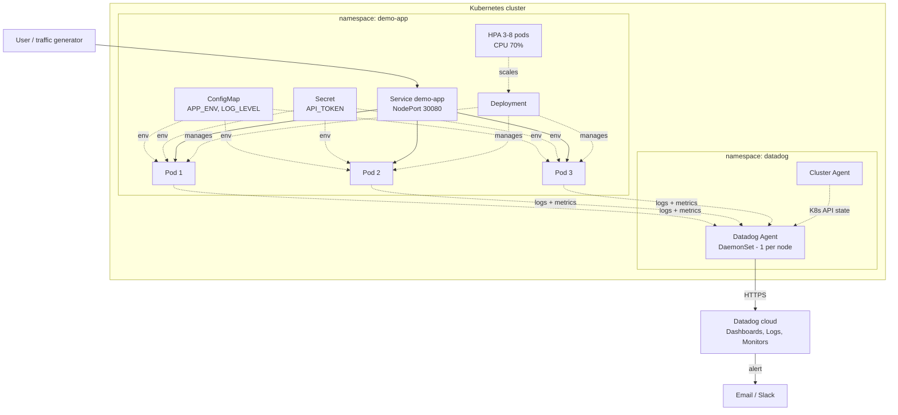

# Kubernetes Deployment & Monitoring with Datadog

A containerized Python app deployed on **Kubernetes** using **Deployments, Services, ConfigMaps, Secrets** and an **HPA**, with full observability from **Datadog**: node, pod and container metrics, centralized logs, Kubernetes state, and alert monitors written as code.

   

---

## Architecture



---

## Kubernetes objects used

| Object | File | Purpose |
|---|---|---|
| Namespace | `00-namespace.yaml` | Isolates the app's resources |
| ConfigMap | `01-configmap.yaml` | Non-secret settings, injected with `envFrom` |
| Secret | `02-secret.example.yaml` | API token, injected with `secretKeyRef` (real one created from the CLI) |
| Deployment | `03-deployment.yaml` | 3 replicas, rolling update, liveness/readiness probes, resource limits, non-root |
| Service | `04-service.yaml` | Stable DNS name + load balancing across ready pods |
| HPA | `05-hpa.yaml` | Scales 3 → 8 pods at 70% CPU |

## What Datadog monitors

| Data | Source |
|---|---|
| Node and container CPU, memory, network | Agent DaemonSet (kubelet) |
| Pod restarts, unavailable replicas, HPA state | kube-state-metrics core |
| Application logs (JSON, with level) | Agent log collection on every container |
| Request latency (`/slow`) and error logs (`/error`) | App endpoints built for the demo |

**Alert monitors (`datadog/monitors/`, created by API):**
1. High CPU per pod
2. Pod restarting more than 3 times in 10 minutes (CrashLoopBackOff)
3. Deployment has unavailable replicas
4. More than 20 error logs in 5 minutes

---

## Project structure

```
.
├── app/                       # Flask app + tests + Dockerfile
├── k8s/                       # Manifests, applied in numeric order
├── datadog/
│   ├── values.yaml            # Helm values for the Datadog Agent
│   └── monitors/*.json        # Alert definitions (Monitoring as Code)
├── scripts/
│   ├── deploy-app.sh
│   ├── install-datadog.sh
│   ├── create-monitors.sh
│   └── generate-traffic.sh
└── docs/interview-guide.md
```

---

## How to run it

**Prerequisites:** Docker, kubectl, Helm, a cluster (Minikube, kind, or EKS), and a Datadog account (14-day free trial).

### 1. Start a cluster (local example)
```bash
minikube start --cpus 4 --memory 6g
minikube addons enable metrics-server     # needed by the HPA
```

### 2. Build and push the image
```bash
docker build -t <your-dockerhub-username>/k8s-datadog-demo:1.0.0 app/
docker push <your-dockerhub-username>/k8s-datadog-demo:1.0.0
```
Update the `image:` line in `k8s/03-deployment.yaml`.

### 3. Deploy the app
```bash
API_TOKEN=my-demo-token ./scripts/deploy-app.sh
minikube service demo-app -n demo-app --url     # open the URL, try /config
```

### 4. Install Datadog and create the alerts
```bash
export DD_API_KEY=<api-key> DD_APP_KEY=<application-key>
./scripts/install-datadog.sh
./scripts/create-monitors.sh
```

### 5. Generate traffic and explore Datadog
```bash
./scripts/generate-traffic.sh 1000
```
In Datadog, open:
- **Infrastructure → Kubernetes:** nodes, pods, deployments
- **Dashboards → Kubernetes - Overview** (built in)
- **Logs:** filter `service:demo-app status:error`
- **Monitors:** your four alerts

### 6. Try self-healing and scaling
```bash
kubectl delete pod -n demo-app -l app=demo-app --wait=false   # pods are recreated instantly
kubectl get hpa -n demo-app -w                                # watch scaling under load
```

### Clean up
```bash
kubectl delete namespace demo-app
helm uninstall datadog-agent -n datadog
```

---

## Interview guide
See [docs/interview-guide.md](docs/interview-guide.md).
